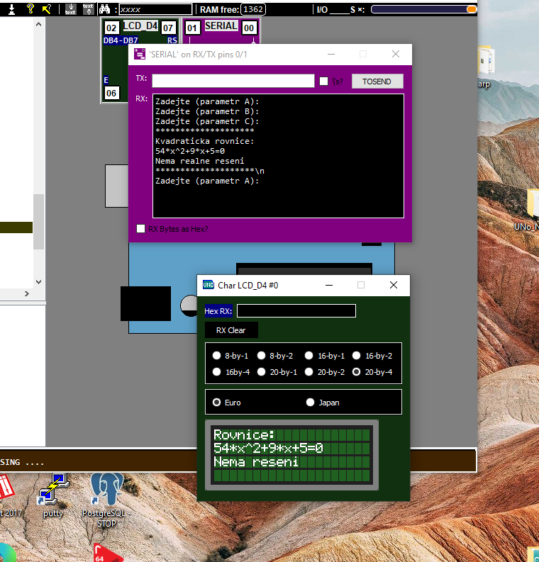

# Architektura počítačů – logické obvody a Arduino

Úkoly z předmětu **Architektura počítačů** (VŠPJ, LS 2024/25): návrh číslicových obvodů v simulátoru **Deeds** a programování mikrokontroléru ATmega328 (**Arduino Uno**) v simulátoru UnoArduSim.

| Složka | Obsah |
|---|---|
| `ukol-01`–`ukol-02` | logická hradla, pravdivostní tabulky, kombinační obvody |
| `ukol-03`–`ukol-04` | dekodéry, multiplexory, sčítačky |
| `ukol-05` | sekvenční obvody – čítač nahoru / dolů |
| `ukol-08` | Arduino: LED a DIP přepínače (digitální vstupy/výstupy) |
| `ukol-09` | sériová komunikace – výpis matice, výpočet objemu |
| `ukol-10` | RS-232 + LCD displej – prvočísla, řešení kvadratické rovnice |
| `ukol-11` | řízení DC motoru a krokového motoru |

## Technologie

Deeds (Digital Electronics Education and Design Suite) · Arduino C/C++ · UnoArduSim

## Jak spustit

- `.pbs` – otevřít v [Deeds](https://www.digitalelectronicsdeeds.com/) (Digital Circuit Simulator).
- `.ino` – otevřít v UnoArduSim (soubory `myArduPrefs.txt` / `myIODevs.txt` obsahují zapojení periferií) nebo nahrát do Arduino IDE.

---
*Školní úkoly – každý commit odpovídá jednomu odevzdání v Moodlu (s původním datem).*
